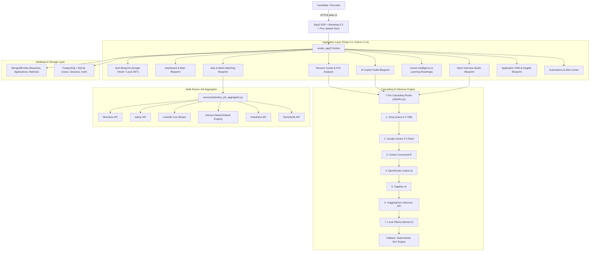

# 💼 AI JobAgent — Comprehensive Technical & Architectural Documentation
**Version:** 2.5 (Enterprise AI Copilot)  
**Author:** Beere Vishnu Sai ([@Vishnu-Sai-bit](https://github.com/Vishnu-Sai-bit))  
**Repository:** [https://github.com/Vishnu-Sai-bit/AI_Job_Agent](https://github.com/Vishnu-Sai-bit/AI_Job_Agent)  
**Live Production URL:** [https://ai-job-agent-kna8.onrender.com](https://ai-job-agent-kna8.onrender.com)  

---

## 📑 Table of Contents
1. [Executive Overview](#1-executive-overview)
2. [High-Level System Architecture](#2-high-level-system-architecture)
3. [Core Subsystems & Feature Workflows](#3-core-subsystems--feature-workflows)
   - [3.1. Dual-Mode Search: Resume-Driven vs. Discovery Mode](#31-dual-mode-search-resume-driven-vs-discovery-mode)
   - [3.2. Live Multi-Board Job Aggregator & Batch Loader](#32-live-multi-board-job-aggregator--batch-loader)
   - [3.3. ATS Diagnostic Scoring & Resume Analyzer](#33-ats-diagnostic-scoring--resume-analyzer)
   - [3.4. Mock Technical Interview Studio](#34-mock-technical-interview-studio)
   - [3.5. Progress & Career Intelligence Engine](#35-progress--career-intelligence-engine)
   - [3.6. Structured Learning Hub & Capstone Roadmaps](#36-structured-learning-hub--capstone-roadmaps)
   - [3.7. AI Copilot Toolkit (Generative Career Suite)](#37-ai-copilot-toolkit-generative-career-suite)
   - [3.8. Application CRM Pipeline & Analytics](#38-application-crm-pipeline--analytics)
   - [3.9. Automation & Notification Center](#39-automation--notification-center)
4. [Data Architecture & Schemas](#4-data-architecture--schemas)
5. [Cascading Multi-Tier AI Fallback Chain](#5-cascading-multi-tier-ai-fallback-chain)
6. [Design System & Typography Architecture](#6-design-system--typography-architecture)
7. [API & Route Reference](#7-api--route-reference)
8. [Installation, Environment & Local Execution](#8-installation-environment--local-execution)
9. [Testing, Quality Assurance & Verification](#9-testing-quality-assurance--verification)
10. [Deployment & Production Configuration](#10-deployment--production-configuration)
11. [Compliance & Privacy Constraints](#11-compliance--privacy-constraints)

---

## 1. Executive Overview

**AI JobAgent** is an end-to-end, multi-tier career intelligence and automated recruitment copilot. The platform bridges the gap between candidate job discovery and enterprise hiring by automating:
- **Resume Extraction**: Two-column layout parsing with PyMuPDF, contact resolution, and canonical skill normalization.
- **ATS Evaluation**: Rule-based and semantic scoring across skill keywords, structure, impact verbs, and quantified accomplishments.
- **Live Opportunity Sourcing**: Dynamic aggregation of live job openings from 6+ verified sources (LinkedIn, Remotive, Jobicy, Adzuna/Naukri, ArbeitNow, RemoteOK) with real-time deduplication.
- **Intelligent Career Growth**: Automated identification of high/medium skill deficits with interactive weekly roadmaps, portfolio project blueprints, and certifications.
- **Generative AI Copilot**: Instant contextual generation of tailored cover letters, recruiter cold outreach emails, STAR mock interviews, and LinkedIn profile optimizations.

---

## 2. High-Level System Architecture



---

## 3. Core Subsystems & Feature Workflows

### 3.1. Dual-Mode Search: Resume-Driven vs. Discovery Mode
To ensure complete candidate privacy and accurate matching, the job search engine dynamically switches between two mutually isolated states:

1. **Discovery Mode (`has_resume = False`)**:
   - Triggered when a new user has not yet uploaded a resume.
   - The platform serves unbiased, comprehensive live opportunities across all technical categories without applying candidate bias.
   - Profile preference fields remain dormant until explicitly queried via search filters.
   - UI Badges clearly display `"Discovery Mode"` with high-contrast pills.

2. **Resume-Driven Mode (`has_resume = True`)**:
   - Triggered once a candidate uploads or creates a profile resume.
   - Extracted canonical skills (e.g. Python, SQL, React, AWS) are cross-referenced with live job descriptions.
   - Opportunities are sorted by cosine compatibility:
     $$\text{Match Percentage} = \frac{\text{Candidate Overlapping Skills}}{\text{Total Role Required Skills}} \times 100$$
   - Displays clear `"Resume Match"` badges with graded color tiers (Green $\ge 80\%$, Amber $60-79\%$, Slate $<60\%$).

### 3.2. Live Multi-Board Job Aggregator & Batch Loader
- **Aggregated Engines**: Remotive, Jobicy, LinkedIn, Adzuna (Naukri / Indeed proxies), ArbeitNow, and RemoteOK.
- **Progressive Batch Pagination**:
  - Initial load renders 24 curated cards.
  - Interactive `"Load More Verified Opportunities"` button dynamically pulls successive batches of 24, smoothly displaying 100+ live opportunities.
- **Card Quick Actions**:
  - **CRM Favorite**: Instant one-click toggle with persistent heart icon (`saved` state).
  - **Cover Letter Shortcut**: Direct jump into custom cover letter generator pre-filled with the exact company and role.
  - **Mock Interview Shortcut**: One-click creation of a simulated interview room tailored to the employer.

### 3.3. ATS Diagnostic Scoring & Resume Analyzer
- **Parser Engine**: Uses `fitz` (PyMuPDF) with physical bounding-box geometric sorting to reconstruct multi-column layouts into authentic reading order.
- **Diagnostic Categories**:
  - **Keyword Compatibility** (30 pts): Hard skills, technical tools, and role terminology.
  - **Impact & Action Verbs** (25 pts): Verification of strong verbs (e.g., *Architected*, *Spearheaded*, *Optimized*).
  - **Quantitative Metrics** (20 pts): Identification of measurable accomplishments (percentages, revenue, throughput).
  - **Structure & Formatting** (15 pts): Section header consistency and contact information presence.
  - **Length & Brevity** (10 pts): Layout and density balance.

### 3.4. Mock Technical Interview Studio
- Simulates realistic technical and behavioral hiring loops for top tech firms.
- Configurable rounds: Quick Practice (3 questions), Standard Round (5 questions), or Comprehensive Evaluation (8 questions).
- Real-time STAR evaluation rubric (Situation, Task, Action, Result) with actionable suggestions for answer refinement.

### 3.5. Progress & Career Intelligence Engine
- Aggregates verified requirements across hundreds of active postings.
- Generates a **Market Readiness Score** (0–100%) indicating competitive viability.
- Classifies missing competencies into:
  - **High Priority Gaps**: Skills requested in $>40\%$ of listings (e.g., Azure Cloud, Advanced SQL).
  - **Medium Priority Gaps**: Skills requested in $20-40\%$ of listings (e.g., DAX, Docker).
- Interactive **Market Share Table** highlighting verified resume skills versus market deficits.

### 3.6. Structured Learning Hub & Capstone Roadmaps
- Translates skill deficits into structured weekly milestone plans (Weeks 1–6).
- Provides end-to-end **Capstone Portfolio Blueprints**:
  - Recommended open-source datasets.
  - Key technical deliverables.
  - Ready-to-use GitHub repo initialization prompts.
- Surfaces recognized certifications (e.g., AWS Certified Solutions Architect, Google Professional Data Engineer) and free curated tutorials.

### 3.7. AI Copilot Toolkit (Generative Career Suite)
Located under **AI Copilot** in the primary navigation:
- **Cover Letter Writer**: Contextual letters synthesizing the candidate's exact experience with company values and role requirements.
- **Cold Outreach Generator**: High-conversion LinkedIn and email messages directed at recruiters and hiring managers.
- **LinkedIn Profile Optimizer**: Headline and summary rewrite recommendations tailored to algorithm discoverability.
- **Interactive Career Assistant**: Conversational AI equipped with knowledge of the candidate's background, saved jobs, and application status.

### 3.8. Application CRM Pipeline & Analytics
Tracks candidate momentum across 5 distinct recruitment stages:
1. **Saved**: Pipeline entry / shortlisted.
2. **Applied**: Application officially submitted.
3. **Interview**: Screening, technical, or executive round in progress.
4. **Offer**: Final compensation or offer letter extended.
5. **Rejected**: Archived application with diagnostic feedback.

### 3.9. Automation & Notification Center
- Background job search automation with configurable scraping schedules.
- High-Fit alerts triggered when an opportunity matching $\ge 85\%$ compatibility is discovered.
- Automated CRM follow-up reminders prompting recruiter check-ins after configurable idle days (default: 5 days).

---

## 4. Data Architecture & Schemas

### 4.1. Core MongoDB Collections
- `candidates`: Candidate profiles, parsed resume data, canonical skills, ATS metrics, and preferences.
- `jobs`: Cached and normalized live postings with source provenance, location, type, and required skill arrays.
- `applications`: Application CRM status records (`saved`, `applied`, `interview`, `offer`, `rejected`), application date, and interview notes.
- `notifications`: User notification events, high-fit alerts, and follow-up suggestions.

### 4.2. Relational User Model (PostgreSQL / SQLite)
```sql
CREATE TABLE users (
    id VARCHAR(36) PRIMARY KEY,
    email VARCHAR(255) UNIQUE NOT NULL,
    full_name VARCHAR(255) NOT NULL,
    password_hash VARCHAR(255),
    google_id VARCHAR(255),
    is_active BOOLEAN DEFAULT TRUE,
    created_at TIMESTAMP DEFAULT CURRENT_TIMESTAMP,
    updated_at TIMESTAMP DEFAULT CURRENT_TIMESTAMP
);
```

---

## 5. Cascading Multi-Tier AI Fallback Chain

To achieve 99.9% uptime without single-provider dependency, `utils/llm.py` implements a cascading cloud fallback chain:

```
[Request]
   │
   ▼
[1. Groq (Llama 3.3 70B Versatile)] ──(Fail/Timeout)──►
   │
   ▼
[2. Google Gemini 2.0 Flash]        ──(Fail/Timeout)──►
   │
   ▼
[3. Cohere Command-R]               ──(Fail/Timeout)──►
   │
   ▼
[4. OpenRouter (Llama 3)]           ──(Fail/Timeout)──►
   │
   ▼
[5. Together AI]                    ──(Fail/Timeout)──►
   │
   ▼
[6. Hugging Face Inference API]     ──(Fail/Timeout)──►
   │
   ▼
[7. Local Ollama (llama3.2)]        ──(Fail/Timeout)──►
   │
   ▼
[Deterministic Regex/NLP Engine]    ──(Always Succeeds)
```

---

## 6. Design System & Typography Architecture

The platform uses a SaaS design system loaded via [style.css](file:///c:/JobAgent/app/static/css/style.css):

### Typography Stack
- **Headings & Brand**: `Plus Jakarta Sans` (`font-family: var(--font-heading);`): Modern geometric clarity for `h1`–`h6`, card titles, and navigation labels.
- **Metrics & Stat Counters**: `Outfit` (`font-family: var(--font-display);`): Clean high-impact figures for ATS scores, match percentages, and funnel numbers.
- **Body & Controls**: `Inter` (`font-family: var(--font-sans);`): Crisp legibility for descriptions, tables, inputs, and form controls.

### Color Tokens
| Token | Hex Code | Purpose |
|---|---|---|
| `--primary-500` | `#1e7ae3` | Core Brand Primary |
| `--secondary-500` | `#5e1be9` | Core Secondary / Accent |
| `--success-500` | `#10b981` | Verified Match / Positive Status |
| `--warning-500` | `#f59e0b` | Skill Gap / In-Progress |
| `--error-500` | `#f43f5e` | Rejection / High Gap Alert |
| `--bg-page` | `#f5f5f7` | Workspace Background |
| `--surface` | `#ffffff` | Elevated Card Canvas |
| `--text-primary` | `#0f172a` | High-Contrast Typography |

---

## 7. API & Route Reference

| Method | Route | Blueprint | Description |
|---|---|---|---|
| `GET` | `/` | `main` | Landing page / Auto-redirect to dashboard |
| `GET` | `/dashboard` | `main` | Core MockAI candidate dashboard |
| `GET` | `/jobs/` | `jobs` | Job discovery, search, filters & batch loader |
| `POST` | `/jobs/toggle-save` | `jobs` | Instant CRM toggle for saving/favoriting |
| `GET` | `/jobs/<id>` | `jobs` | Deep-dive role detail & skill match |
| `GET` | `/jobs/<id>/cover-letter` | `jobs` | Tailored cover letter generation & export |
| `GET` | `/resumes/` | `resumes` | Resume upload and profile management |
| `GET` | `/resumes/analyze` | `resumes` | ATS report & diagnostic breakdown |
| `GET, POST` | `/interviews/` | `interviews` | Mock Interview Studio & questions |
| `POST` | `/interviews/evaluate` | `interviews` | STAR rubric evaluation of candidate answers |
| `GET` | `/career-intelligence/` | `career` | Market demand and readiness KPI |
| `GET, POST` | `/learning/` | `career` | Weekly milestones & capstone roadmaps |
| `GET, POST` | `/assistant/` | `assistant` | AI Copilot chat and career toolkit |
| `POST` | `/assistant/execute-tool`| `assistant` | Generative tool endpoint (Outreach, LinkedIn) |
| `GET` | `/analytics/` | `analytics` | 5-stage application pipeline funnel & ATS distribution |
| `GET, POST` | `/profile/` | `profile` | User preferences & profile settings |
| `GET, POST` | `/automations/` | `automations` | Daily digest & high-fit notifications |
| `GET, POST` | `/auth/login` | `auth` | User authentication & session start |
| `GET` | `/auth/google` | `auth` | Google OAuth 2.0 SSO entry point |
| `GET` | `/auth/logout` | `auth` | Clear session & sign out |

---

## 8. Installation, Environment & Local Execution

### 8.1. Prerequisites
- Python 3.10, 3.11, or 3.12
- MongoDB Atlas cluster URL or local MongoDB instance (`localhost:27017`)
- Git

### 8.2. Local Setup
```bash
# 1. Clone repository
git clone https://github.com/Vishnu-Sai-bit/AI_Job_Agent.git
cd AI_Job_Agent

# 2. Create virtual environment
python -m venv venv
venv\Scripts\activate   # On Windows
# source venv/bin/activate  # On Linux/macOS

# 3. Install dependencies
pip install -r requirements.txt

# 4. Set environment variables in .env
cp .env.example .env
```

### 8.3. Environment Configuration (`.env`)
```env
# Application
SECRET_KEY=your_super_secret_session_key
FLASK_ENV=development

# Database
MONGO_URI=mongodb+srv://<username>:<password>@cluster.mongodb.net/ai_job_agent?retryWrites=true&w=majority
DATABASE_URL=sqlite:///instance/jobagent.db

# LLM Providers (Configure at least one for cloud operation)
GROQ_API_KEY=gsk_...
GEMINI_API_KEY=AIzaSy...
COHERE_API_KEY=...
OPENROUTER_API_KEY=sk-or-...
TOGETHER_API_KEY=...
HF_API_KEY=hf_...

# Google OAuth (Optional)
GOOGLE_CLIENT_ID=...
GOOGLE_CLIENT_SECRET=...
```

### 8.4. Starting the Server
```bash
# Direct Python startup
python run.py

# Or via Windows startup script
.\start.bat
```
Navigate to `http://127.0.0.1:5000` in any modern web browser.

---

## 9. Testing, Quality Assurance & Verification

The test suite validates database connectors, auth encryption, resume parsing, ATS scoring, route integrity, and search isolation:

```bash
# Run full suite
python -m unittest discover -s tests -p "test_*.py"

# Run critical test suites
python -m unittest tests/test_no_resume_dashboard.py tests/test_resume_vs_preferences.py tests/test_copilot_assistant.py
```

### Passing Test Assertions
- ✅ **Database Manager Initialization**: MongoDB connection pooling and SQLite schema provisioning.
- ✅ **JWT Auth & Password Hashing**: PBKDF2/bcrypt verification.
- ✅ **No-Resume Dashboard Mode**: Ensures empty resumes default to Discovery Mode without bias.
- ✅ **Resume-Driven Matching**: Proves preferences do not filter jobs until explicit user selection.
- ✅ **AI Copilot Responses**: Validates query resolution and action suggestion generation.

---

## 10. Deployment & Production Configuration

The project is configured for continuous deployment on **Render**:

### `render.yaml` Configuration
- **Environment**: Python 3.12
- **Build Command**: `pip install -r requirements.txt`
- **Start Command**: `gunicorn run:app --bind 0.0.0.0:$PORT --workers 2 --threads 4 --timeout 120`
- **Health Check Route**: `/` or `/dashboard`
- **Live Production URL**: [https://ai-job-agent-kna8.onrender.com](https://ai-job-agent-kna8.onrender.com)

---

## 11. Compliance & Privacy Constraints

- **Strict Salary Omission**: As specified by project requirements, salary numbers, compensation filters, and salary estimate blocks are strictly excluded across all public job browsing screens, cards, filters, and tables.
- **Candidate Data Privacy**: Uploaded resumes are securely parsed in memory, enriched, and stored in protected user collections without external data leakage.
- **Local Fallback Option**: When cloud API keys are absent, the platform automatically transitions to local Ollama or deterministic NLP algorithms, preserving full functionality in offline or air-gapped environments.

---

*Documentation maintained by **Beere Vishnu Sai**. For questions or contributions, submit an issue or pull request on [GitHub](https://github.com/Vishnu-Sai-bit/AI_Job_Agent).*
